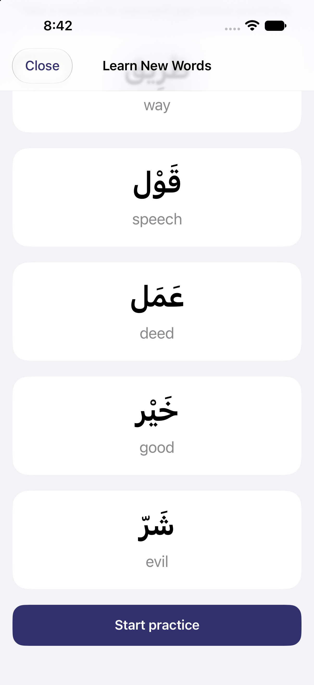
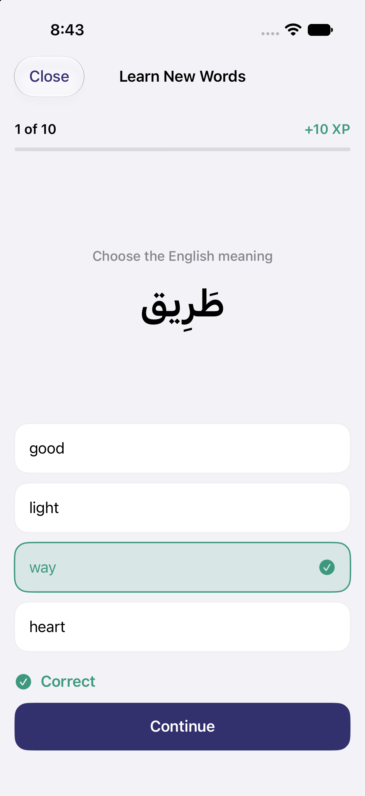
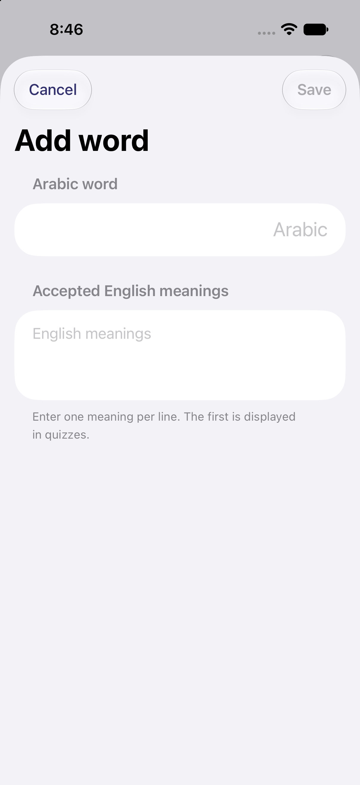
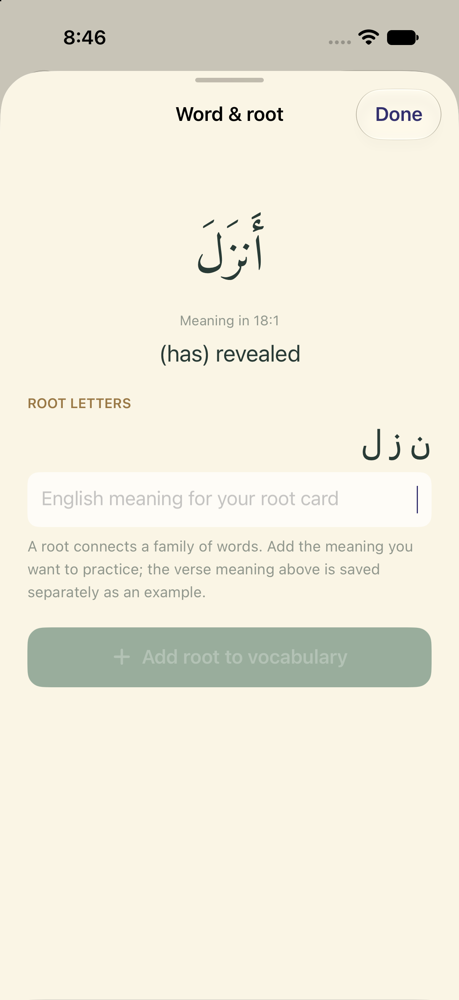

I've been studying Quranic Arabic for a few years now. While the grammar (nahw) and sarf (morphology) rules are very ingrained in me, my vocabulary has really struggled to keep up. I've been taking my Arabic courses through [Fawakih](https://fawakih.org/) and I can't recommend them enough. However, they include a ton of vocabulary in all of their materials, which you end up having to memorize
on your own time.

Fawakih provides an experience through community-curated Arabic vocab lists, which correspond
roughly to each unit in the curriculum. This is great, actually -- Memrise's platform does spaced
repetition really well, and I feel like I was able to memorize words consistently by doing
each unit one at a time. But some lessons didn't have all the words I wanted to know, and
some curriculums weren't updated. Also, I would run into new words with hadith that I wanted
to add to my long-term memory, but never could due to Memrise limitations. Also, the curriculums
exist only on the website, not in the mobile app -- this got changed in early 2022, which is
frustrating.

I wanted to build my own spaced repetition app, which allowed me to also add my own vocabulary
and even read Quran with the ability to add my own vocabulary words.

Enter: Mubtader.

## Spaced Repetition

The unique feature behind Mubtader is the ability to add your own words to a local corpus.
Every word you add gets added to the spaced repetition system, where you get quizzed on the
Arabic - English translation and also the English -> Arabic translation. The learning flow starts with multiple-choice questions, and reviews can quiz me in either
direction, with typing exercises as well.

<figure style="margin: 0; flex: 1 1 240px; max-width: 320px;">
  
  <figcaption>A small set of new words to learn.</figcaption>
</figure>
<figure style="margin: 0; flex: 1 1 240px; max-width: 320px;">
  
  <figcaption>Practicing recall, one question at a time.</figcaption>
</figure>

<figure style="margin: 0; flex: 1 1 240px; max-width: 320px;">
  
  <figcaption>Adding my own vocabulary, including alternate English meanings.</figcaption>
</figure>

## Quranic reading

One thing that I really wanted to do was read Quran, and if I encountered words I didn't know,
I could add them to practice for the corpus. So I've added a Quran section where I can read Quran
word by word and add words that I don't know to my practice. This is an exercise I do if I'm trying
to really understand what I'm reading, and I'm glad that I can do that on the go.

<figure style="margin: 0; flex: 1 1 240px; max-width: 320px;">
  
  <figcaption>Saving a root from the Quran reader, with the verse meaning kept as an example.</figcaption>
</figure>

## How I built it

Mubtader is a native iPhone app built with Swift and SwiftUI. This is an almost entirely
AI-generated project, but the requirements came from how I wanted to study: add my own
words, practice them regularly, and bring unfamiliar vocabulary from my reading into
that same practice loop.

The app works offline, without an account or a backend. Vocabulary and review progress
are encoded as JSON and saved separately in `UserDefaults` on the device. Each word has
a stable ID, so editing a meaning or importing an updated vocabulary list doesn't have
to erase the progress attached to it. I can add words individually or import a JSON file;
the import previews changes before merging them into the existing collection.

The spaced repetition logic is a small scheduler. A new learning session introduces five
unseen words and asks two questions about each. After two correct encounters, a word moves
into spaced review. Correct answers advance its stage and increase the time until the
next review; an incorrect answer moves it back a stage and schedules another attempt
in four hours. Keeping that logic separate from the screens makes it easier to check
what happens when I get an answer right or wrong.

The Quran reader adds another layer. A Python build script prepares the Quran text and
word-by-word English meanings from Quran.com, then joins them with root annotations from
the Quranic Arabic Corpus using the surah, ayah, and word position. The resulting data
for all 114 surahs is bundled with the app, along with the Amiri Quran font, so reading
and looking up words don't require a connection.

A word's meaning in a particular verse isn't necessarily a definition of its root.
The app keeps those separate: I supply the meaning I want to practice for a root card,
and the original word and verse meaning are saved as an example. Finding another word
with the same root adds another example to the existing card without resetting my
progress. If a root annotation isn't available, I can save the word on its own.

Arabic also needs some care when comparing input. The vocabulary editor ignores
diacritics, tatweel, and common alif variants when checking for duplicate words. That
comparison doesn't change the Quran text displayed in the reader. The project includes
tests for review scheduling, vocabulary edits, Arabic normalization, and the Quran data,
plus UI tests for the reader. With so much generated code, those checks and actually
using the app are an important part of the work.

## Future Updates

I definitely want to expand the practice activities and spend more time testing the study
flow. Typing exercises and a Settings screen are already in place, but there's still plenty
of room to refine the experience as I use it for my own Arabic study. Not for public release
yet, still working on ironing out the bug. Definitely looking
forward to building more!
